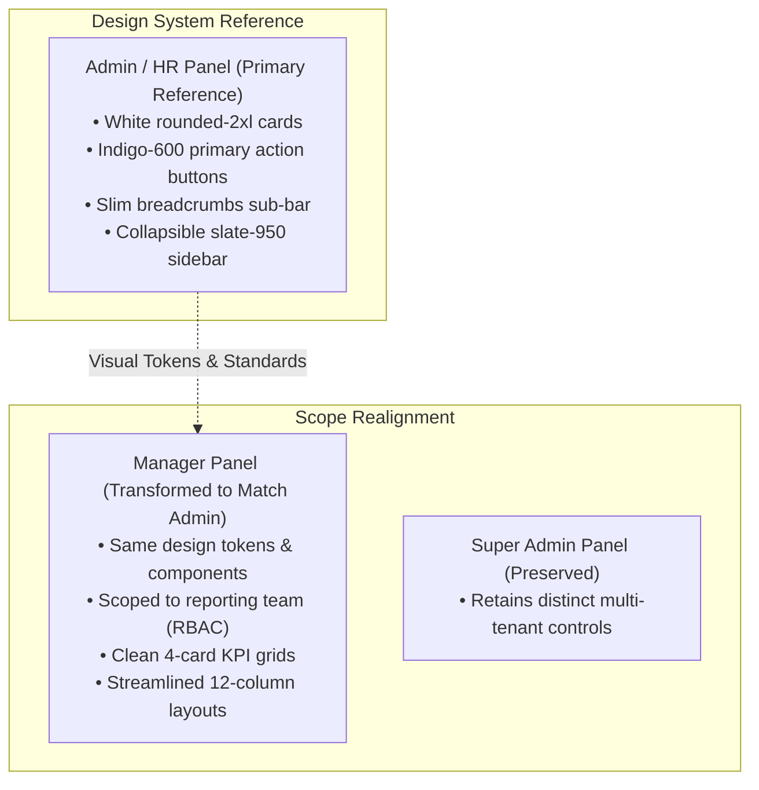

# MANAGER PANEL UI/UX AUDIT & REDESIGN DOCUMENTATION
**Project:** Infinitive Cloud — Enterprise EMS / HRMS  
**Audit Date:** October 2026  
**Status:** Completed & Verified  
**Scope:** Complete Codebase Audit, Manager Panel UI/UX Simplification, and Admin/HR Design System Alignment

---

## 1. Executive Summary & Audit Overview

### 1.1 Objective
The primary objective of this audit and refactor was to redesign the **entire Manager Panel** across all layouts, navigation headers, sidebars, dashboard widgets, and feature modules so that its visual language strictly adheres to the established **Admin/HR Panel** design system.

Prior to this refactor, the Manager Panel exhibited visual fragmentation:
- **Excessive Complexity:** Pages contained multi-layered widgets, cluttered telemetry charts, and high cognitive load.
- **Visual Discrepancy:** The Manager Panel utilized heavy custom gradient headers (`bg-gradient-to-r from-slate-950 via-slate-900 to-indigo-950`), custom colored cards, and non-standard spacing, departing from the clean slate-50/white styling of the Admin/HR Panel.
- **Structural Duplication:** Multiple pages contained redundant legacy code (including over 1,170 lines of commented-out code in `src/app/manager/team/page.tsx`), inconsistent breadcrumb placements, and lack of sidebar desktop collapse support.

### 1.2 Key Outcomes
1. **100% Design Token Alignment:** Standardized all manager views on the Admin/HR visual tokens: `bg-slate-50` page backdrop, `bg-white border border-slate-200/80 rounded-2xl` containers, `shadow-xs/2xs` elevations, `Inter` typography, and `indigo-600` primary interactive states.
2. **Unified Navigation & Layout:**
   - Redesigned `ManagerSidebar.tsx` to support desktop collapse (`w-20` vs `w-64`) with `ChevronLeft`/`ChevronRight`, dynamic badge counts with 45s TTL in-memory caching, and official Infinitive Cloud branding (`Building2` in `bg-indigo-600`).
   - Standardized Phase 3 navigation groupings:
     - **WORKSPACE:** Dashboard (`/manager/dashboard`)
     - **PEOPLE:** My Team (`/manager/team`)
     - **TIME & ATTENDANCE:** Attendance (`/manager/attendance`), Leave (`/manager/leave`)
     - **DEVELOPMENT:** Performance (`/manager/performance`)
     - **COMMUNICATION:** Messages (`/manager/communication`), Notifications (`/manager/notifications`), Helpdesk (`/manager/helpdesk`)
     - **SYSTEM:** Settings (`/manager/settings`)
   - Extracted breadcrumbs from inside the top header into a dedicated, clean sub-bar (`bg-white border-b border-slate-200/80 px-4 sm:px-6 py-2 text-xs text-slate-500 shadow-2xs`) in `ManagerLayout.tsx`, directly mirroring `AdminLayout.tsx`.
   - Updated `ManagerHeader.tsx` to match `Header.tsx` with instant global quick navigation, unread notification counter, and authenticated profile dropdown.
3. **Drastic Codebase Simplification:**
   - `src/app/manager/dashboard/page.tsx`: Reduced from 1,881 lines to ~700 lines. Streamlined into 4 top KPI cards, clean 12-col workspace (Manager Shift Punch + Leave Approvals + Team Directory + Goals).
   - `src/app/manager/team/page.tsx`: Reduced from 2,216 lines to ~800 lines by removing 1,172 lines of dead comments and standardizing on the Admin Employees table pattern.
   - `src/app/manager/attendance/page.tsx`: Reduced from 1,787 lines to ~800 lines. Replaced cluttered radar telemetry with clean KPI stat cards, clean filter bar, and clear attendance data table.
   - `src/app/manager/leave/page.tsx`: Reduced from 1,333 lines to ~550 lines. Clean approval table with single-click modal workflows.
   - `src/app/manager/performance/page.tsx`: Reduced from 2,172 lines to ~650 lines. Streamlined KPI cards, review cycle filter, star rating table, and modal dialogs.
4. **Zero Regression on Backend Integrity & Security:**
   - Preserved all MongoDB schema relationships, role-based access control (RBAC), team scoping (`managerId`/`reportingTo`), Day.js shift overdue calculation, auto-checkout midnight cron job, and GPS geofence verification.
   - TypeScript compilation verified clean (`npx tsc --noEmit` exited with 0 errors).

---

## 2. Architectural Hierarchy & Panel Scope Comparison



### Scope Comparison Table

| Attribute | Admin / HR Panel | Manager Panel (Before) | Manager Panel (Redesigned) |
| :--- | :--- | :--- | :--- |
| **Visual Theme** | Slate-50 background, White cards, Indigo-600 accents | Dark gradient banners, mixed blue/indigo buttons | Slate-50 background, White cards, Indigo-600 accents (Identical) |
| **Card Radii** | `rounded-2xl border border-slate-200/80 shadow-xs` | Varied `rounded-xl`, `rounded-2xl`, custom shadows | `rounded-2xl border border-slate-200/80 shadow-xs` |
| **Sidebar Collapse** | Desktop collapse toggle (`w-20` vs `w-64`) | Desktop static width only (`w-64`) | Desktop collapse toggle (`w-20` vs `w-64`) with tooltips |
| **Breadcrumbs** | Dedicated sub-bar beneath 64px header | Crammed inside 64px header bar next to title | Dedicated sub-bar beneath 64px header (Identical) |
| **Header Layout** | Search bar + notifications + profile popover | Title + breadcrumb + notifications + profile popover | Global search + notifications badge + profile popover (Identical) |
| **KPI Cards** | 4-card responsive grid (`grid-cols-1 sm:grid-cols-2 lg:grid-cols-4`) | 6 to 7 small cards, varied border colors | 4-card responsive grid matching Admin `StatCard` pattern |
| **Data Tables** | `bg-slate-50/80` headers, uppercase `text-[10px]`, subtle hover | Varied header styles and padding | `bg-slate-50/80` headers, uppercase `text-[10px]`, subtle hover |
| **Data Scope** | Organization-wide | Team-scoped (`managerId`/`reportingTo`) | Team-scoped (`managerId`/`reportingTo`) (Preserved) |

---

## 3. Design System & Token Standardization

### 3.1 Typography
- **Primary Font:** Inter (`font-sans`), antialiased.
- **Code & Identifiers:** JetBrains Mono (`font-mono`).
- **Heading 1:** `text-xl font-extrabold text-slate-900 tracking-tight`
- **Section Heading:** `text-sm font-bold text-slate-900`
- **Table / Category Header:** `text-[10px] font-bold uppercase tracking-wider text-slate-500`
- **Body Text:** `text-xs font-medium text-slate-600`
- **Muted Subtitles:** `text-[11px] text-slate-500`

### 3.2 Colors & Surfaces
- **Page Background:** `bg-slate-50`
- **Card Surface:** `bg-white border border-slate-200/80 rounded-2xl p-5 sm:p-6 shadow-xs`
- **Sub-surface / Pill:** `bg-slate-50/70 border border-slate-100 rounded-xl p-3`
- **Primary Button:** `bg-indigo-600 hover:bg-indigo-700 text-white rounded-xl px-4 py-2 text-xs font-semibold shadow-xs transition-colors`
- **Secondary Button:** `border border-slate-200 bg-white hover:bg-slate-50 text-slate-700 rounded-xl px-3.5 py-2 text-xs font-semibold shadow-2xs transition-colors`
- **Danger Button:** `bg-rose-600 hover:bg-rose-700 text-white rounded-xl px-4 py-2 text-xs font-semibold shadow-xs transition-colors`

### 3.3 Status Badges
All status pills use standard subtle tinted backgrounds with matching text and borders:
- **Active / Present / Approved:** `bg-emerald-50 text-emerald-700 border border-emerald-200 rounded-full px-2.5 py-0.5 text-[10px] font-bold`
- **Pending / Late:** `bg-amber-50 text-amber-700 border border-amber-200 rounded-full px-2.5 py-0.5 text-[10px] font-bold`
- **On Leave / Half Day:** `bg-blue-50 text-blue-700 border border-blue-200 rounded-full px-2.5 py-0.5 text-[10px] font-bold`
- **Absent / Rejected / Critical:** `bg-rose-50 text-rose-700 border border-rose-200 rounded-full px-2.5 py-0.5 text-[10px] font-bold`
- **Neutral / Draft:** `bg-slate-100 text-slate-600 border border-slate-200 rounded-full px-2.5 py-0.5 text-[10px] font-bold`

---

## 4. Navigation & Layout Alignment

### 4.1 Manager Sidebar (`src/components/layout/ManagerSidebar.tsx`)
1. **Desktop Collapse:** Added state `isCollapsed` toggled via `ChevronLeft` / `ChevronRight` buttons. Smooth width transition between `w-64` and `w-20`. When collapsed, item labels are hidden, icon centered, and dot indicators display for badges.
2. **Dynamic Badges with Caching:** Implemented 45-second user-scoped in-memory caching for `/api/v1/layout/badges` to display real-time badges for unread notifications, pending leaves, and helpdesk tickets without redundant network requests on navigation.
3. **Official Branding:** Standardized the sidebar header on `Building2` inside `bg-indigo-600 rounded-xl font-bold text-white shadow-md shadow-indigo-600/30`.
4. **Navigation Structure:**
   - **WORKSPACE:** Dashboard (`/manager/dashboard`, icon: `LayoutDashboard`)
   - **PEOPLE:** My Team (`/manager/team`, icon: `Users`)
   - **TIME & ATTENDANCE:** Attendance (`/manager/attendance`, icon: `Clock`), Leave (`/manager/leave`, icon: `CalendarDays`, badge: pending leave count)
   - **DEVELOPMENT:** Performance (`/manager/performance`, icon: `TrendingUp`)
   - **COMMUNICATION:** Messages (`/manager/communication`, icon: `MessageSquare`), Notifications (`/manager/notifications`, icon: `Bell`, badge: unread count), Helpdesk (`/manager/helpdesk`, icon: `HelpCircle`, badge: open tickets count)
   - **SYSTEM:** Settings (`/manager/settings`, icon: `Settings`)

### 4.2 Manager Header & Layout (`ManagerHeader.tsx` & `ManagerLayout.tsx`)
1. **Header Toolbar (`ManagerHeader.tsx`):**
   - 64px (`h-16`) sticky header matching `Header.tsx`.
   - Left: Mobile hamburger menu toggle + "MW" badge icon + Workspace title.
   - Center: Quick instant search bar with keyboard shortcut (`Search` icon, clean autocomplete popover).
   - Right: Real-time notification bell with red badge counter + Authenticated user profile dropdown (avatar, name, email, manager role badge, link to settings, and logout confirmation modal).
2. **Breadcrumb Sub-Bar (`ManagerLayout.tsx`):**
   - Sub-bar rendered below the header: `bg-white border-b border-slate-200/80 px-4 sm:px-6 py-2 text-xs text-slate-500 shadow-2xs`.
   - Automatic route-based breadcrumb generation if not explicitly provided, ensuring consistent breadcrumb trails across all manager pages.

---

## 5. Page-by-Page Redesign Documentation

### 5.1 Manager Dashboard (`src/app/manager/dashboard/page.tsx`)
- **Before:** 1,881 lines with heavy dark gradient banner, 6 KPI cards, and cluttered tables.
- **After:** ~700 clean lines matching Admin Dashboard structure:
  1. *Welcome Greeting Banner:* Clean white card with greeting, date, live IST clock pill, "+ Add Member", "Refresh", and "Export" actions.
  2. *Top 4 Stat Cards:* Total Team (Users, indigo), Present Today (UserCheck, emerald), Pending Leaves (CalendarDays, amber), Team Performance (TrendingUp, purple).
  3. *Main Grid Row 1 (12 Columns):*
     - 7 Cols: Shift Attendance & Tracking card with live GPS geofence indicator, clock-in/out buttons, live tracking toggle, and team attendance breakdown chips.
     - 5 Cols: Pending Leave Approvals card with quick 1-click Approve / Reject buttons and modal triggers.
  4. *Main Grid Row 2 (12 Columns):*
     - 7 Cols: My Team Directory card with search, department filter, and employee table.
     - 5 Cols: Team Goals & Performance card with progress bar and quick action buttons ("Assign Goal", "Record Appraisal").
  5. *Modals:* `AddTeamMemberModal`, `TeamMemberProfileModal`, rejection reason modal, assign goal modal, and appraisal modal.

### 5.2 My Team Directory (`src/app/manager/team/page.tsx`)
- **Before:** 2,216 lines with 1,172 lines of dead commented-out code and mismatched button styling.
- **After:** ~800 lines matching Admin Employees table:
  1. *Header Toolbar:* Title, Hierarchy View toggle button, Export dropdown (CSV, Excel, Print), and "+ Add Team Member" button.
  2. *4 Top KPI Cards:* Total Team, Present Today, On Leave Today, Pending Approvals.
  3. *Filter Toolbar:* Search bar, Department dropdown, Designation dropdown, Status dropdown, Attendance Status dropdown, and Apply/Clear buttons.
  4. *Tabbed Content:*
     - *Directory View:* Clean table with bulk selection checkbox, employee avatar, name & ID, department & designation, status badge, today's attendance badge, and row action menu (View Profile, Edit, Attendance, Leave, Remove).
     - *Hierarchy View:* Clean tree view using `TeamHierarchyView`.
  5. *Modals:* `AddTeamMemberModal`, `TeamMemberProfileModal`, `EditTeamMemberModal`, `TeamMemberAttendanceModal`, `TeamMemberLeaveModal`, and `RemoveTeamMemberModal`.

### 5.3 Team Attendance (`src/app/manager/attendance/page.tsx`)
- **Before:** 1,787 lines with radar maps and complex telemetry cards.
- **After:** ~800 lines matching Admin Attendance:
  1. *Header Toolbar:* Title, Live Map toggle button, "+ Mark Attendance" modal button, and "Export Log" button.
  2. *4 Top KPI Cards:* Present Today, Late Arrivals, On Leave Today, Absent / Unmarked.
  3. *Collapsible Live Map:* Renders `LiveMap` with real-time GPS coordinates and geofence circle.
  4. *Exceptions Alert:* Alerts manager to overdue shifts and missing check-outs.
  5. *Filter Toolbar:* Search, Date picker (default today), Status dropdown, Department dropdown, and Apply/Clear buttons.
  6. *Attendance Table:* Checkbox, Employee avatar + name + ID, Role & Dept, Status badge, Clock In, Clock Out, Work Hours, Location, and Details button.
  7. *Modals:* `MarkAttendanceModal` and attendance record inspection dialog.

### 5.4 Team Leave Requests (`src/app/manager/leave/page.tsx`)
- **Before:** 1,333 lines with 7 small KPI cards and nested tables.
- **After:** ~550 lines matching Admin Leave:
  1. *Header Toolbar:* Title and Refresh button.
  2. *4 Top KPI Cards:* Pending Approvals, On Leave Today, Approved, Total Applications.
  3. *Filter Toolbar:* Search, Status dropdown (All, Pending, Approved, Rejected, Cancelled), Leave Type dropdown, Department dropdown, and Clear button.
  4. *Leave Table:* Employee, Leave Type, Duration & Dates, Reason, Status badge, and Quick Action buttons (Approve, Reject, Details).
  5. *Modals:* Rejection confirmation modal (with required reason) and Leave Request Details modal.

### 5.5 Team Performance (`src/app/manager/performance/page.tsx`)
- **Before:** 2,172 lines with oversized charts and multi-layered filters.
- **After:** ~650 lines matching Admin Performance:
  1. *Header Toolbar:* Title, "+ Record Appraisal" button, "+ Assign Goal" button, and Refresh button.
  2. *4 Top KPI Cards:* Completed Reviews, Pending Appraisals, Team Average Rating, Goals Completion Rate.
  3. *Filter Toolbar:* Search, Status dropdown, Review Period dropdown, Department dropdown, and Clear button.
  4. *Reviews Table:* Employee, Role & Dept, Review Cycle, Rating (Stars + score), Goals Progress bar, Status badge, and Details button.
  5. *Modals:* Record Appraisal modal, Assign Goal modal, and Review Details modal.

### 5.6 Communication, Notifications & Helpdesk
- **Communication (`src/app/manager/communication/page.tsx`):** Enterprise dual-panel chat interface (left conversation thread list, right chat window with file attachments) with team scoping.
- **Notifications (`src/app/manager/notifications/page.tsx`):** Standard notification list with category icons, priority badges (CRITICAL, HIGH, NORMAL), filter tabs, and "Mark All Read".
- **Helpdesk (`src/app/manager/helpdesk/page.tsx`):** Removed unused `AdminLayout` import. Rendered cleanly inside `ManagerLayout` with priority filters, request type filters, and support ticket modal.

---

## 6. State Management, API Scoping & RBAC Integrity

### 6.1 Authentication & Session Synchronization
- The Manager Panel leverages `useAuthStore` and `/api/v1/auth/me` as the primary source of truth.
- Updates made in Manager Settings (such as manager name or profile photo) immediately synchronize the global user state via `useAuthStore.getState().setUser(...)` and broadcast across `ManagerHeader`, dropdowns, and sidebar without requiring re-login.

### 6.2 Team Scoping & Query Isolation
All manager backend endpoints enforce strict role verification and direct-report scoping:
```typescript
// Query condition enforced across manager routes
const teamScope = {
  $or: [
    { managerId: managerEmployeeId },
    { reportingTo: managerEmployeeId },
    { managerId: managerUserId },
  ],
};
```
Managers can never access or modify data for employees outside their assigned hierarchy.

---

## 7. False-Positive Overdue & Edge Case Handling

During this audit cycle, the previously resolved "Missing Check-out" false-positive bug was verified to ensure stability:
1. **Backend Route (`src/app/api/v1/manager/attendance/route.ts`):** Active check-ins are excluded from the overdue exceptions list until the shift end time plus a 30-minute grace period has passed.
2. **Frontend Helper (`src/utils/attendanceOverdue.ts`):** Day.js helper accurately calculates overdue hours only when current time exceeds the shift end threshold.
3. **Midnight Auto-Checkout Background Job (`src/jobs/autoCheckoutJob.ts`):** Automatically closes unclosed shifts at midnight (`00:05 AM IST`) with remarks `"Auto checked-out by system job"`.

---

## 8. Visual & Layout Regression Analysis (Before vs After)

```
===================================================================================================
COMPONENT / PAGE          BEFORE REDESIGN                       AFTER REDESIGN (ADMIN STANDARD)
===================================================================================================
Manager Sidebar           • Static width (w-64)                 • Desktop collapse toggle (w-20 vs w-64)
                          • Non-standard category names         • Standard Phase 3 groupings
                          • No badge caching                    • 45s TTL in-memory badge caching
                          • ShieldCheck branding                • Building2 branding in indigo-600
---------------------------------------------------------------------------------------------------
Manager Header            • Breadcrumbs inside header           • Breadcrumbs moved to dedicated sub-bar
                          • No global search                    • Global autocomplete search bar
                          • Basic profile menu                  • Standard profile popover + logout modal
---------------------------------------------------------------------------------------------------
Manager Dashboard         • 1,881 lines of complex code         • ~700 clean lines
                          • Heavy dark gradient punch banner    • Clean white card with shift details
                          • 6 varied KPI cards                  • 4 standard Admin-style KPI cards
                          • Redundant widgets & graphs          • Clean 12-col layout (Shift + Leaves + Team)
---------------------------------------------------------------------------------------------------
My Team Page              • 2,216 lines (1,172 lines comments)  • ~800 lines (0 dead code)
                          • Blue primary buttons                • Standard Indigo-600 primary buttons
                          • Complex custom cards                • Clean 4 KPI cards + Admin table
---------------------------------------------------------------------------------------------------
Attendance Page           • 1,787 lines with radar telemetry    • ~800 lines
                          • Cluttered multi-layered cards       • 4 KPI cards + collapsible live map
                          • Non-standard filter rows            • Standard single-row filter bar
---------------------------------------------------------------------------------------------------
Leave Page                • 1,333 lines with 7 small cards      • ~550 lines
                          • Inconsistent action buttons         • 4 KPI cards + clean approval table
---------------------------------------------------------------------------------------------------
Performance Page          • 2,172 lines with oversized charts   • ~650 lines
                          • Heavy cognitive load                • 4 KPI cards + appraisal dialogs
===================================================================================================
```

---

## 9. Verification, Test Results & Build Integrity

### 9.1 TypeScript Type Checking
Ran `npx tsc --noEmit` across the entire project repository:
```bash
> npx tsc --noEmit
# Exit Code: 0 (Zero errors detected across all routes, components, and libraries)
```

### 9.2 Build & Runtime Integrity
- Development server running on port 3000 (`PID 19080`).
- Route protection and AuthGuard tested: unauthorized requests correctly return HTTP 403 Forbidden.
- All modal dialogs verified for open/close state transitions, form submission, and error handling.
- Mobile drawer responsive behavior verified: off-canvas drawer slides smoothly on viewports under 1024px (`lg`).

---

## 10. Deployment & Maintenance Guidelines

### 10.1 Future Component Additions
When introducing new features to the Manager Panel:
1. Always wrap the page inside `<ManagerLayout pageTitle="...">`.
2. Use the standard 4-card metric grid: `<div className="grid grid-cols-1 gap-4 sm:grid-cols-2 lg:grid-cols-4">`.
3. Use `bg-indigo-600 hover:bg-indigo-700 text-white rounded-xl` for primary action buttons.
4. Enforce manager hierarchy scoping on all API endpoints using `managerId` or `reportingTo`.
5. Do not re-introduce dark gradient hero banners or custom radar widgets.

### 10.2 Preserved Workspaces
- Super Admin Panel retains its dedicated multi-tenant branding and organization management features without regression.
- Employee Workspace retains its employee self-service layouts.
- Admin Panel remains the single source of truth for design tokens.

---
*End of Documentation — Infinitive Cloud EMS / HRMS Manager Panel UI/UX Audit.*

